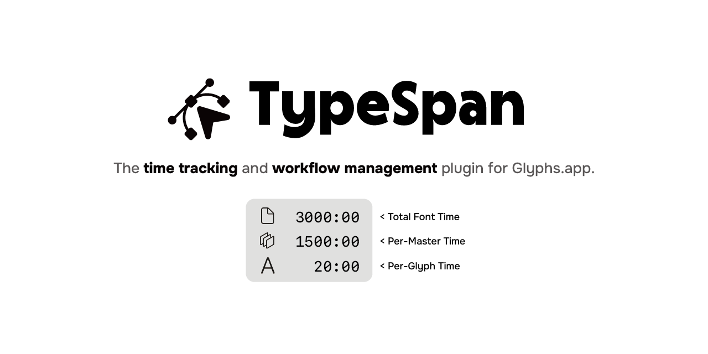

# TypeSpan

[Official website](https://typespan.com) · [Guide](https://typespan.com/guide)

Time tracking and local reports for [Glyphs 3 and 4](https://glyphsapp.com/).

TypeSpan records the time you spend on each glyph and master. Its report opens in your browser from a server on your Mac. A device on the same local network can also open the full report link while Glyphs is running. Keep that link private. Reports are not uploaded to TypeSpan.

## Install

1. In Glyphs, open **Window > Plugin Manager**.
2. Under **Modules**, install **Python** and **Vanilla**.
3. Under **Plugins**, find **TypeSpan** and click **Install**.
4. Fully quit and reopen Glyphs.

You can also download `TypeSpan.glyphsReporter` from this repository and double-click it to install, then restart Glyphs.

## Track time

In the Glyphs **View** menu, enable **Show TypeSpan**. Open a glyph in Edit view to see its timer. Tracking pauses when Glyphs is in the background or you pause it from the context menu.

Open **Window > TypeSpan Preferences** to adjust the timer and data storage. New fonts use the default storage mode shown there. Fonts with existing TypeSpan data continue using Legacy storage unless you choose to migrate them.

- **Legacy:** Time records are stored in the Glyphs file.
- **External:** Time records are stored in a private JSON log on this Mac. The Glyphs file keeps one stable log ID, so routine tracking does not add Git changes. The local log is not shared automatically with collaborators and needs its own backup.

Changing an existing font from Legacy to External asks for confirmation and creates backups before moving its tracking records.

## Open a report

Choose **File > Export TypeSpan Report**. TypeSpan opens the complete report immediately in your browser. Keep Glyphs running while you view it. You can download a JSON snapshot from the report page. Hosted report sharing is no longer available.

## Plans

Hobby includes 1,000 minutes of tracking per font. Pro removes that limit and includes priority support. Manage your subscription and API key at [typespan.com/account](https://typespan.com/account).

## Support

- [Guide](https://typespan.com/guide)
- [FAQ](https://typespan.com/faq)
- [Email](mailto:hello@typespan.com)

Copyright (c) 2026 TypeSpan. All rights reserved.
